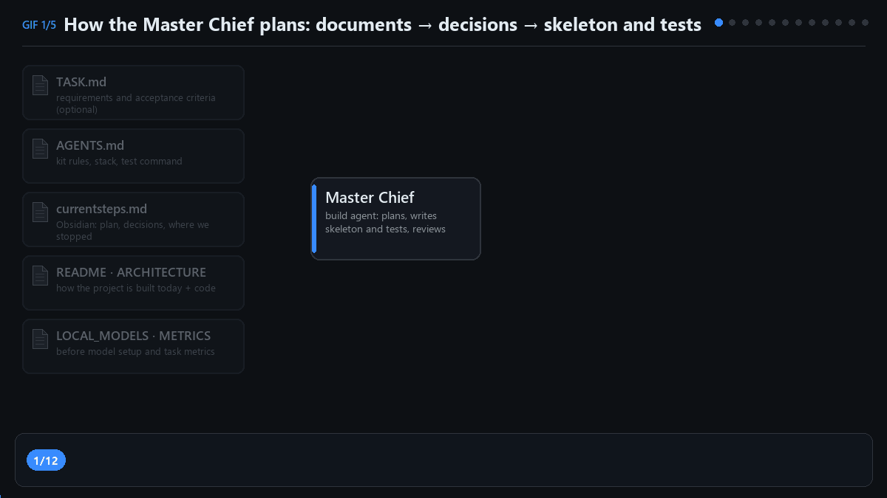
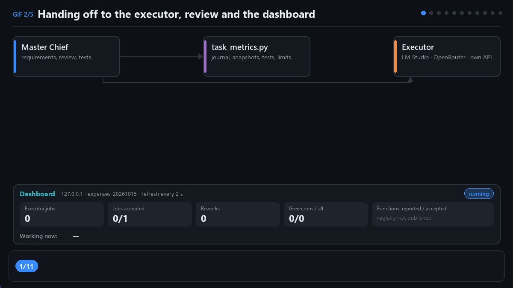
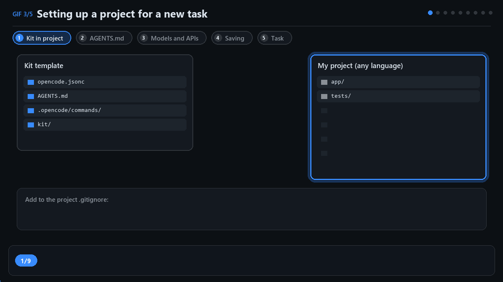
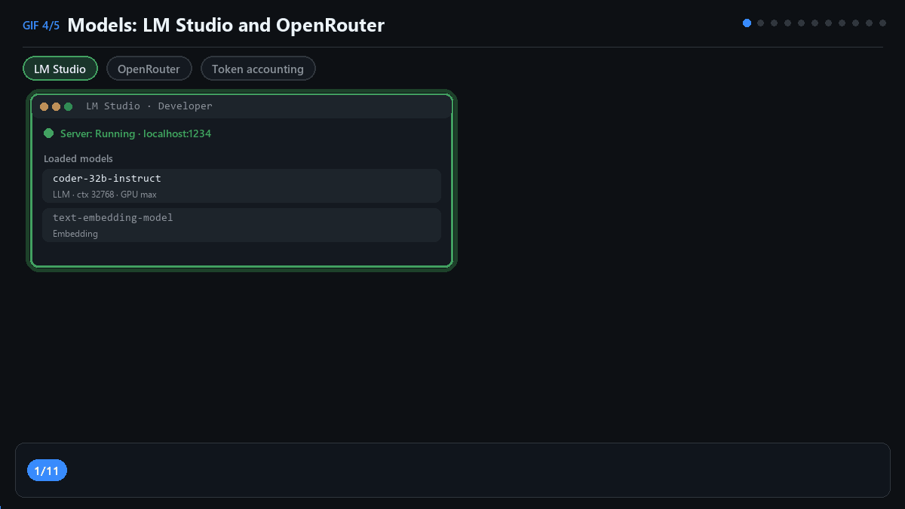
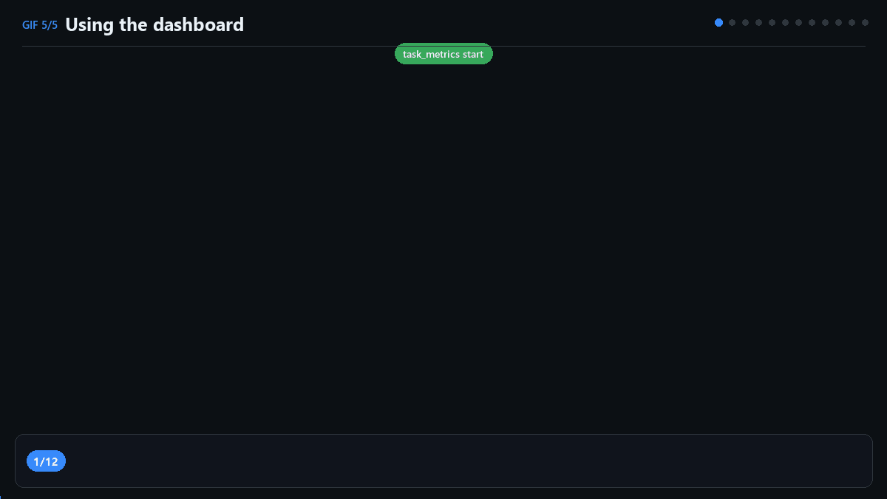

# Quick start: the OpenCode kit, step by step in plain words

> A from-scratch guide for people who do not write code every day.
> Русская версия: [QUICKSTART.ru.md](QUICKSTART.ru.md) · Project overview: [README.en.md](README.en.md)

This guide shows, step by step, how to plug the kit into your project, choose
models and give the first task. The example is a small Java application, but
the order is the same for any language. Five animated diagrams show each stage.
The data in the diagrams is sample data.

---

## 1. What this is and why

Think of a building site. There is a **foreman** who reads the order, draws
the plan, hands out work and accepts the result. And there are **workers** who
carry out small, clear jobs exactly as drawn.

The kit works the same way:

- 🪖 **Master Chief** — the main AI agent (called `build` in OpenCode). Usually
  a strong cloud model. It understands the task, designs the program, writes
  a code "skeleton" with detailed explanations plus the tests, and then reviews
  the executor's work.
- 🛠 **Executor** — a simpler, cheaper model: a local one in LM Studio or a
  free/low-cost cloud one. It fills in only the "insides" of functions from a
  ready description and touches nothing else.
- 📒 **Journal and dashboard** — a tracking script records every step, and a
  browser page shows what is happening right now.

Your part: say what you need, answer questions and accept the result.
The Master Chief runs the commands, checks and statistics itself.

### How the Master Chief plans the work

When it gets a task, the Master Chief first reads the project documents:
the requirements (your message or a `TASK.md` file), the kit rules (`AGENTS.md`),
the plan from earlier sessions (`currentsteps.md`) and a description of the
existing code. Then it decides which parts the program needs and in what order.
For each part it creates a blank: function names and a detailed description of
what each one must do. It writes the tests right away — small automatic checks.
While the functions are empty the tests fail ("red"), and that is expected:
they are waiting for the work to be done.



### How work is handed to the executor and checked

Before each job the Master Chief writes down the list of requirements and takes
a "snapshot" of every project file. The executor gets one file and fills in the
empty functions. Right after that, the script compares the files with the
snapshot: if the executor touched anything else, the work goes back. Then the
Master Chief checks every requirement against the code and the tests. If
something is missing, it returns the work with a remark (a "rework"). If all
is well, it accepts it, and the dashboard counts more finished functions.

If the same job keeps coming back, or tests keep giving no result, a guard
kicks in: everything stops with the word `STOP`, and the Master Chief waits for
your decision. There is no endless loop.



A simple example of the cycle:

```
you:          Build a task-list API. Show me the plan first.
Master Chief: proposes a plan and the order of parts
you:          The plan looks good. Do all of it.
Master Chief: skeleton + descriptions + tests (tests are red for now — by design)
              └─ hands the executor one small complete class
executor:     fills in the functions from the description
Master Chief: checks code and tests → part done → picks the next one itself
              at the end — results and statistics for the whole task
```

---

## 2. A few words you will meet

| Word | Meaning |
| --- | --- |
| **Model** | The AI "brain" that writes text and code. Cloud models run on the internet, local ones on your computer. |
| **LM Studio** | An app that runs a model on your own computer. Free and offline, but needs a strong graphics card. |
| **OpenRouter** | A service that gives access to hundreds of cloud models, including free ones (their name ends with `:free`). |
| **API and API key** | The address of a model service and the "password" for it. The key lives in a Windows user variable, not in project files. |
| **Test** | A tiny program that checks a function works correctly. Green = passed, red = failed. |
| **Skeleton** | A code blank: function names and descriptions without the "insides". |
| **Tokens** | Pieces of text a model reads and writes. They show how much work each model did. |
| **Dashboard** | A browser page showing how the task is going. It opens by itself. |

---

## 3. What to install

| What | Why | How to check |
| --- | --- | --- |
| OpenCode (Desktop is easiest) | the app where the agents live | the OpenCode window opens |
| Python 3.13 with tkinter | for the kit scripts and the model settings window | `py --version` (macOS/Linux: `python3 --version`) |
| A model for the executor | LM Studio **or** access to a cloud model (e.g. OpenRouter) | see section 7 |
| Tools for your language | for the example: JDK 21 and Maven | `java -version`, `mvn -v` |

> Python is needed by the kit itself (plan lookup, checks, tracking), not by your app.
> Commands here are for Windows, where Python starts with `py`.
> On macOS and Linux use `python3` instead of `py`.

---

## 4. Step 1. Create a project (Java example)

If you already have a project, skip to step 2.

1. Open [start.spring.io](https://start.spring.io).
2. Choose: **Project:** Maven, **Language:** Java, **Spring Boot:** latest stable 3.x,
   **Java:** 21, **Dependencies:** `Spring Web`, `Validation`.
3. Click **Generate** — an archive downloads. Unzip it, e.g. to `D:\PROJECTS\task-api`.

```
task-api/
├── pom.xml
└── src/
    ├── main/java/com/example/taskapi/
    └── test/java/com/example/taskapi/
```

---

## 5. Step 2. Put the kit into the project



The diagram shows the whole preparation: copying the kit, editing `AGENTS.md`,
choosing models and the two ways to give a task. The same steps are described
in detail below.

Copy four things from this repository into the project root:

```
opencode.jsonc        ← which agents exist and what they may do
AGENTS.md             ← the Master Chief's working rules
kit/                  ← kit scripts (tracking, dashboard, model settings)
.opencode/commands/   ← optional /plan-project and /module commands
```

Result:

```
task-api/
├── opencode.jsonc
├── AGENTS.md
├── kit/
├── .opencode/
├── pom.xml
└── src/
```

Add these lines to the project `.gitignore` so personal settings and journals
stay out of Git:

```gitignore
.opencode/opencode.jsonc
.opencode/opencode.jsonc.tmp
.opencode/kit-models.json
.metrics/
```

---

## 6. Step 3. Tell the kit about your project (`AGENTS.md`)

In `AGENTS.md` you change only the sections marked `# EDIT`. The rest are
general rules; leave them alone.

**`Project stack`** — the language and, most importantly, the test command:

```md
## Project stack  # EDIT: language, build tool, test command
- Language: Java 21 (`java -version`). Build tool: Maven (`mvn`).
- Tests: JUnit 5. Maven writes one JUnit XML file per test class into `target/surefire-reports`.
- Test command (always through task_metrics):
  `py kit/task_metrics.py test --task <ID> --junit-dir target/surefire-reports -- mvn -q test`
- Compile only: `mvn -q compile`.
- Run the app: `mvn spring-boot:run`.
```

**`Project layout`** — where the code and tests live:

```md
## Project layout  # EDIT: folders and files of this project
- `src/main/java/com/example/taskapi/` — application code.
- `src/test/java/com/example/taskapi/` — tests.
- `pom.xml` — Maven build file.
```

**`Work plan (memory)`** — the plan file name, `currentsteps.md` by default.
With Obsidian installed the plan lives in your vault; without it, in the project root.

Ready-made test commands for other languages are in
[Adding your language](README.en.md#adding-your-language).

### Check that the kit can read test results

Run this once in a terminal in the project root:

```bash
py kit/task_metrics.py check --junit-dir target/surefire-reports -- mvn -q test
```

- `CHECK OK` — all good. Failing tests do not matter at this step.
- `CHECK FAILED` — the script cannot read the result. Hints follow below the
  line: for example, Maven is missing or the project does not build.

The Master Chief also runs this check before every task and writes no code
until it passes.

---

## 7. Step 4. Choose the models



Each role needs its own "brain". The options:

| Source | Good when | What you need |
| --- | --- | --- |
| **Local · LM Studio** | you have a strong computer and want free, offline work | load a model in LM Studio and start its server |
| **Model from OpenCode** | the model is already connected in OpenCode via `/connect` (OpenCode Go, a ChatGPT subscription, OpenRouter, …) | just pick it in the settings |
| **Own API** | any OpenAI-compatible service, OpenRouter included | API address, key and model name |

If you configure nothing, the Master Chief uses the model from `opencode.jsonc`
and the executors use the model loaded in LM Studio.

### Path A. Executor in LM Studio (local)

1. Open LM Studio and load a coding model (the **Load** button). You choose the
   context size, GPU use and other settings: the kit never changes them and
   never loads or unloads models itself.
2. Start the server: **Developer → Start Server**.
3. With one model loaded, the kit uses it. With several, it uses the one chosen
   in the settings, or lists them and asks you to pick. Embedding models
   (used for search) are skipped.
4. Do not unload the model during a task. Changed the model? Ask the Master
   Chief to prepare the settings again.

### Path B. A cloud model via OpenRouter

1. Open the model settings window: the **model settings** button in the
   dashboard, or ask the Master Chief: "Open this project's model configurator".
   (The window runs with `py -m kit.configurator.app` from the project root.)
2. Click the big **OpenRouter — Model catalog & prices** button. The list loads
   without a key. Prices are in US dollars per 1M tokens, input and output
   separately. "—" means the price is unknown.
3. Turn on the filters **For coding**, **Tool support only** (agents cannot work
   without tools) and, if you like, **Free models**.
4. Above the table, in **Assign to:**, pick the role — **Executors** or
   **Master Chief** — and click a model row. The role gets "Own API", the address
   `https://openrouter.ai/api/v1` and the exact model ID. The click saves nothing yet.
5. Click **Role settings**. Paste your OpenRouter key (you get it in your
   openrouter.ai account). If a key is already saved, the window shows
   **✓ Key found** and you need not type it again. One `OPENROUTER_API_KEY`
   works for both roles.
6. Click **Check connection**: OpenRouter confirms it accepted the key.
   No generation runs and nothing is saved.

Alternatively, connect OpenRouter inside OpenCode with `/connect` and pick
**Model from OpenCode** for the role, e.g. `openrouter/…:free`.

### Path C. Own API

In the role section choose **Own API** and fill in:

1. **API address** — the base address like `https://api.example.com/v1`,
   without `/chat/completions` or `/models`.
2. **API key** — shown as dots. An empty field keeps the saved key.
3. **Model** — **Get models** loads the list, or type the name yourself.

**Check connection** tells you whether the service answers. For a generic API
it checks the `/models` address, which does not always prove the key is valid.

### Save and apply

- **Save settings** writes the choice to `.opencode/kit-models.json` for this
  folder. The key itself lives in a Windows user variable; the project file
  stores only the variable name. Never send keys in chat.
- **Prepare OpenCode** builds the overlay file `.opencode/opencode.jsonc`.
  The current chat does not switch models: open a **new build chat**. If you
  just added a new key, fully restart OpenCode Desktop so it sees it.

The configurator window has an English interface by default (Language → Russian
switches it).

If you work from a terminal rather than Desktop, launch with preparation like this:

```powershell
py kit/run_opencode.py
```

More on model selection: [LOCAL_MODELS.ru.md](LOCAL_MODELS.ru.md) and the
[configurator guide](kit/configurator/UX.ru.md) (both in Russian).

### Check the connection to the executor

Ask the Master Chief:

```text
Check the environment using kit/check_env.py. Read the result of the
trial model request and explain what needs configuring if it fails.
```

The `ready for use` line appears only when the settings are valid, the model
answers and the trial request succeeded.

---

## 8. Step 5. Give the task

Open the project folder in OpenCode and create a new **build** chat. There are
two equal ways:

**Way A — straight in chat.** Just describe what you need:

```text
Build a task-list REST API on Spring Boot: create, list, complete, and
delete tasks. Keep data in memory for now.
Show me the plan first and explain the order of work.
```

**Way B — with a `TASK.md` file.** Write the requirements and acceptance
criteria in `TASK.md` in the project root, save it and send one word in chat:
**"Start"**.

Good to know:

- If chat and file disagree, the chat message wins.
- The Master Chief never overwrites `TASK.md` unless you ask.
- You do not need to list documents: it finds `AGENTS.md`, the plan and README itself.
- Opening the folder alone starts nothing; a chat message does.

The Master Chief opens task tracking and launches the dashboard in your browser.
Then it shows the plan: which parts the task splits into and in what order.

Example plan:

```md
## Modules
- [ ] model      — Task + store
- [ ] service    — list / create / complete / delete
- [ ] controller — REST endpoints
```

You do not need to know these names in advance; the Master Chief chooses the
parts and their order. Check the plan matches your task and reply, for example:
"The plan looks good. Implement the whole plan, verify it, and show task statistics."

---

## 9. Step 6. Watch the work in the dashboard



While you do other things, the dashboard shows:

- **Overview** — task status, how often work was sent back, test runs and the
  latest events. Refreshes every 2 seconds.
- **Working now** — which model does what, which function is in progress, how
  many parts are accepted, tokens used and time elapsed.
- **Work details** — every executor job: attempts, files, tests, review result.
- **Tokens** — usage per model. Missing data says "unknown", never zero.

> The dashboard page itself is currently in Russian; the diagram shows its
> labels in English for readability.

Task control buttons:

| Button | What happens |
| --- | --- |
| **⏸ Pause** | The Master Chief and all executors stop. Code, plan and history are kept. New actions for the task are blocked until you resume. |
| **▶ Resume** | The Master Chief is asked to continue the same task: re-read the plan and check what was done before the pause. |
| **■ Stop** | The task is cancelled and message queues are cleared. This is not a "successful finish". |
| **Delete task…** | After confirmation, this task's sessions and journal are deleted. Your application code stays. |
| **Model settings** | Opens the model selection window. Nothing applies by itself; the choice is for the next task. |

Details and limits: [task controls](kit/dashboard/CONTROLS.ru.md) (in Russian).

---

## 10. Step 7. What the Master Chief does after you approve the plan

From here it runs on its own, part by part:

1. Creates a function **skeleton** with a description and a placeholder:
   ```java
   public Task create(String title) {
       throw new UnsupportedOperationException("TODO: executor");
   }
   ```
2. Writes the **tests** (`TaskServiceTest.java`) and runs them — they are red, by design.
3. Asks the **executor** to fill in one small complete class.
4. The executor fills in **only the function bodies**.
5. The Master Chief checks nothing else was touched, matches requirements
   against code and runs the tests. A mistake goes back to the executor.
   A build or setup problem the Master Chief fixes itself or brings to you.
6. Part done — it ticks it off in the plan and takes the next one.
7. A guard fires (`STOP`) — it explains why and waits for your decision:
   clarify the job, fix the tests or fix the setup.

It comes to you only when access or tools are missing, or a decision would
change the task. Moving between parts needs no further approval.

---

## 11. Step 8. Get the result

At the end the Master Chief always runs **all** project tests, then shows the
outcome and the statistics:

- how long the task took;
- tokens of paid models, local ones (LM Studio) and free cloud ones (`:free`);
- how many times work was sent back;
- how many test runs passed.

The dashboard shows a **✓ Work complete** block with buttons to open the project
folder, view the launch file and the final report.

To try the application for real, ask:

```text
Start the application and check creating, listing, completing, and
deleting a task through the API. Show the results and explain how
to stop the application.
```

---

## 12. Continuing after a break

The Master Chief writes what is done, the decisions and the next steps into
`currentsteps.md`. In a new chat just say:

> Read the project plan and continue with the next task.

---

## 13. Troubleshooting

| What you see | Why | What to do |
| --- | --- | --- |
| `Result: test failed` in `check_env` | LM Studio is not running or no model is loaded | Developer → Start Server; press Load on the model |
| No "Key found" although you saved a key | OpenCode or the window started before the key was saved | Restart OpenCode Desktop and reopen the settings window |
| "Check connection" reports an error | Wrong address or key, or the service is down | Check the address (`…/v1`) and key, try again later |
| The chat still uses the old model | The current chat never switches | "Prepare OpenCode", then a new build chat |
| `/module` not visible | `.opencode/` not copied, or OpenCode opened outside the project root | Check the project folder |
| `mvn` not found | Maven not installed or not on PATH | Install Maven, restart the terminal |
| OpenCode rejects `providers`/`agents` | An old OpenCode from PATH is running | See [Which OpenCode the kit uses](README.en.md#which-opencode-the-kit-uses) |
| Tests do not compile | An import is missing in the skeleton (executors never add imports) | Tell the Master Chief: "add the missing import to the skeleton" |
| `CHECK FAILED` | The script cannot read test results | Read the hints; check the test command in `AGENTS.md` |
| The Master Chief writes `STOP` and waits | A loop guard fired | Read the reason, decide, and tell it to continue |
| The Master Chief does everything itself | It cannot see `AGENTS.md` | Make sure `AGENTS.md` is in the project root |
| `currentsteps.md` is not created in Obsidian | Obsidian was not found | Normal: the plan stays in the project root |

---

## 14. Next steps

- [README.en.md](README.en.md) — project overview, statistics, other languages.
- [PIPELINE.ru.md](PIPELINE.ru.md) — exactly how executor work is checked (in Russian).
- [METRICS.ru.md](METRICS.ru.md) — how statistics are counted (in Russian).

After the one-time setup you simply describe the task and approve the plan.
The Master Chief manages the order of work, the executors, the checks and the statistics.
