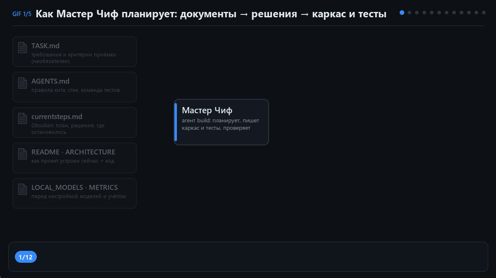
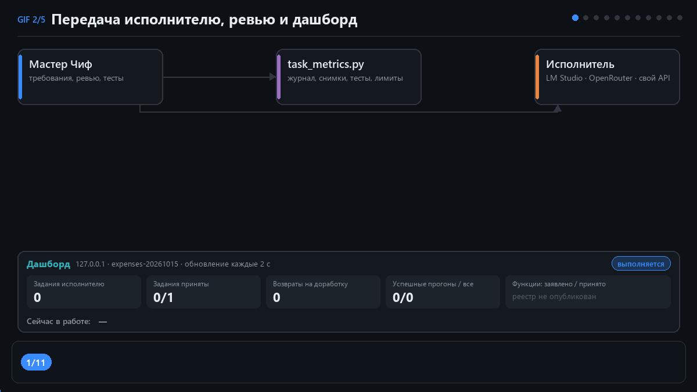
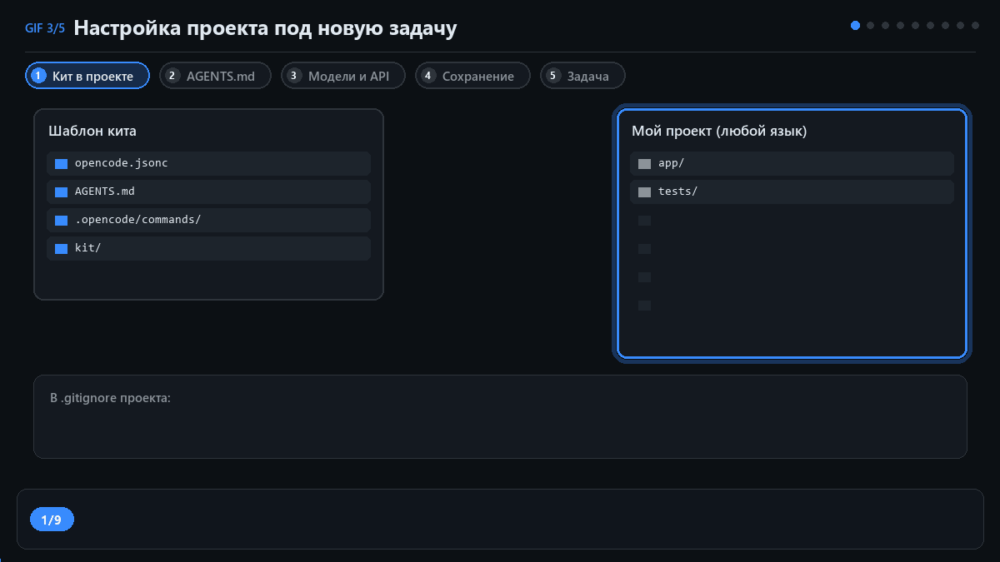
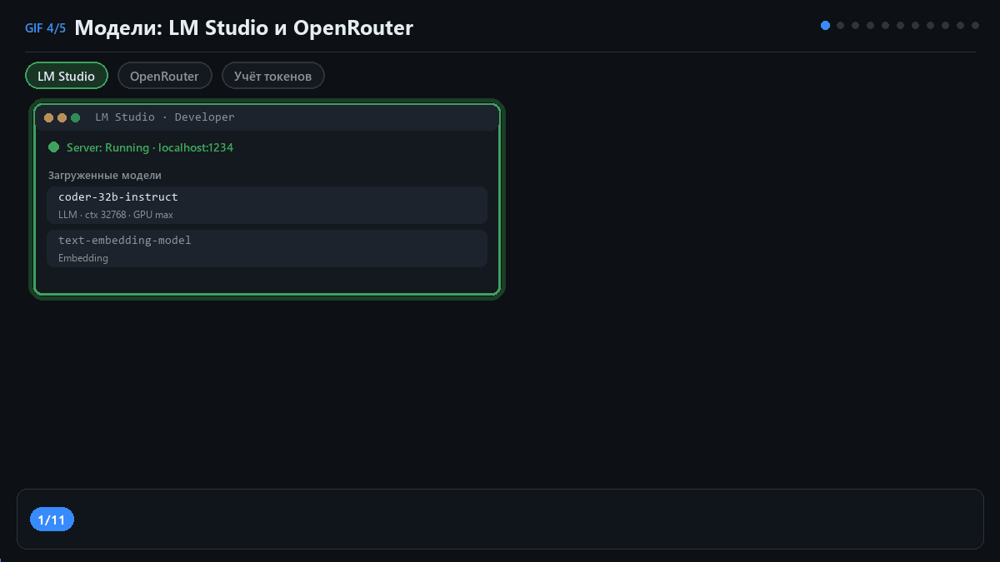
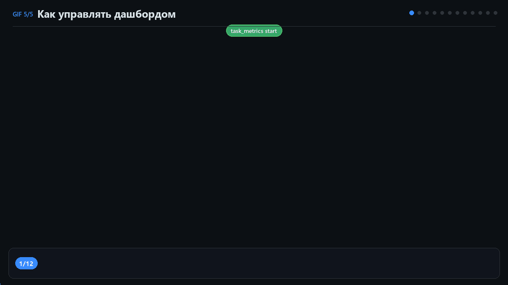

# Быстрый старт: кит для OpenCode, понятно и по шагам

> Инструкция «с нуля» для тех, кто не программирует каждый день.
> English version: [QUICKSTART.en.md](QUICKSTART.en.md) · Обзор проекта: [README.md](README.md)

Здесь по шагам описано, как подключить кит к своему проекту, выбрать модели
и поставить первую задачу. Пример — небольшое приложение на Java, но порядок
одинаков для любого языка. Пять анимированных схем показывают каждый этап.
Данные в схемах примерные.

---

## 1. Что это и зачем

Представь стройку. Есть **прораб**, который читает задание, чертит план,
раздаёт работу и принимает результат. И есть **рабочие**, которые выполняют
небольшие понятные поручения строго по чертежу.

В этом ките так же:

- 🪖 **Мастер Чиф** — главный ИИ-агент (в OpenCode он называется `build`).
  Обычно это сильная облачная модель. Он разбирается в задаче, придумывает
  устройство программы, пишет «скелет» кода с подробными пояснениями и тесты,
  а потом проверяет работу исполнителя.
- 🛠 **Исполнитель** — более простая и дешёвая модель: локальная в LM Studio
  или бесплатная/недорогая облачная. Она заполняет только «внутренности»
  функций по готовому описанию и больше ничего не трогает.
- 📒 **Журнал и дашборд** — скрипт учёта записывает каждый шаг, а страница
  в браузере показывает, что сейчас происходит.

Твоя роль — сказать, что нужно сделать, ответить на вопросы и принять результат.
Команды, проверки и статистику Мастер Чиф выполняет сам.

### Как Мастер Чиф планирует работу

Получив задачу, Мастер Чиф сначала читает документы проекта: требования
(твоё сообщение или файл `TASK.md`), правила кита (`AGENTS.md`), план
прошлых сессий (`currentsteps.md`) и описание того, что уже есть в коде.
Затем он решает, из каких частей будет программа и в каком порядке их делать.
Для каждой части он создаёт заготовку: названия функций и подробное описание,
что каждая должна делать. Сразу же пишет тесты — маленькие автоматические
проверки. Пока функции пустые, тесты не проходят («красные»), и это нормально:
они ждут, когда работу выполнят.



### Как работа передаётся исполнителю и проверяется

Перед каждым поручением Мастер Чиф записывает список требований и делает
«снимок» всех файлов проекта. Исполнитель получает один файл и заполняет
пустые функции. Сразу после этого скрипт сравнивает файлы со снимком: если
исполнитель тронул что-то лишнее, работа возвращается. Затем Мастер Чиф
сверяет каждое требование с кодом и тестами. Если чего-то не хватает,
он возвращает работу с замечанием («возврат на доработку»). Если всё верно,
он принимает её, и в дашборде растёт число готовых функций.

Если одна и та же работа возвращается слишком часто или тесты раз за разом
не дают результата, срабатывает защита: всё останавливается со словом `STOP`,
и Мастер Чиф ждёт твоего решения. Бесконечного цикла не будет.



Простой пример цикла:

```
ты:          Нужен API списка задач. Сначала покажи план.
Мастер Чиф:  предлагает план и порядок частей
ты:          План подходит. Сделай его целиком.
Мастер Чиф:  каркас + описания + тесты (тесты пока красные — так и задумано)
             └─ отдаёт исполнителю небольшой класс целиком
исполнитель: заполняет функции по описанию
Мастер Чиф:  проверяет код и тесты → часть готова → сам берёт следующую
             в конце — результат и статистика всей задачи
```

---

## 2. Несколько слов, которые встретятся дальше

| Слово | Что значит |
| --- | --- |
| **Модель** | «Мозг» ИИ, который пишет текст и код. Бывают облачные (в интернете) и локальные (на твоём компьютере). |
| **LM Studio** | Программа, которая запускает модель прямо на твоём компьютере. Бесплатно, без интернета, но нужна мощная видеокарта. |
| **OpenRouter** | Сайт-посредник, через который можно подключить сотни облачных моделей, в том числе бесплатные (их имя оканчивается на `:free`). |
| **API и API-ключ** | Адрес сервиса с моделями и «пароль» к нему. Ключ хранится в переменной Windows, а не в файлах проекта. |
| **Тест** | Маленькая программа, которая проверяет, что функция работает правильно. Зелёный — прошёл, красный — нет. |
| **Каркас** | Заготовка кода: названия и описания функций без «внутренностей». |
| **Токены** | Кусочки текста, которыми модель читает и пишет. По ним видно, сколько работы сделала каждая модель. |
| **Дашборд** | Страница в браузере, где видно, как идёт задача. Открывается сама. |

---

## 3. Что нужно установить

| Что | Зачем | Как проверить |
| --- | --- | --- |
| OpenCode (лучше Desktop) | программа, в которой живут агенты | открывается окно OpenCode |
| Python 3.13 с tkinter | для скриптов кита и окна настроек моделей | `py --version` (macOS/Linux: `python3 --version`) |
| Модель для исполнителя | LM Studio **или** доступ к облачной модели (например, OpenRouter) | см. раздел 7 |
| Инструменты твоего языка | для примера: JDK 21 и Maven | `java -version`, `mvn -v` |

> Python нужен самому киту (поиск плана, проверки, учёт), а не твоему приложению.
> Команды здесь написаны для Windows, где Python запускается командой `py`.
> На macOS и Linux вместо `py` пиши `python3`.

---

## 4. Шаг 1. Создать проект (пример на Java)

Если проект у тебя уже есть, переходи к шагу 2.

1. Открой [start.spring.io](https://start.spring.io).
2. Выбери: **Project:** Maven, **Language:** Java, **Spring Boot:** последняя
   стабильная 3.x, **Java:** 21, **Dependencies:** `Spring Web`, `Validation`.
3. Нажми **Generate** — скачается архив. Распакуй его, например, в `D:\PROJECTS\task-api`.

```
task-api/
├── pom.xml
└── src/
    ├── main/java/com/example/taskapi/
    └── test/java/com/example/taskapi/
```

---

## 5. Шаг 2. Положить кит в проект



Схема выше показывает весь путь подготовки: копирование кита, правку
`AGENTS.md`, выбор моделей и два способа поставить задачу. Ниже эти же шаги
расписаны подробно.

Скопируй в корень проекта четыре вещи из этого репозитория:

```
opencode.jsonc        ← какие агенты есть и какие у них права
AGENTS.md             ← правила работы Мастер Чифа
kit/                  ← скрипты кита (учёт, дашборд, настройки моделей)
.opencode/commands/   ← необязательные команды /plan-project и /module
```

Получится:

```
task-api/
├── opencode.jsonc
├── AGENTS.md
├── kit/
├── .opencode/
├── pom.xml
└── src/
```

Добавь в `.gitignore` проекта строки, чтобы личные настройки и журналы
не попали в Git:

```gitignore
.opencode/opencode.jsonc
.opencode/opencode.jsonc.tmp
.opencode/kit-models.json
.metrics/
```

---

## 6. Шаг 3. Рассказать киту о своём проекте (`AGENTS.md`)

В `AGENTS.md` меняются только разделы с пометкой `# EDIT`. Остальное — общие
правила, их трогать не нужно.

**`Project stack`** — язык и, главное, команда запуска тестов:

```md
## Project stack  # EDIT: language, build tool, test command
- Language: Java 21 (`java -version`). Build tool: Maven (`mvn`).
- Tests: JUnit 5. Maven writes one JUnit XML file per test class into `target/surefire-reports`.
- Test command (always through task_metrics):
  `py kit/task_metrics.py test --task <ID> --junit-dir target/surefire-reports -- mvn -q test`
- Compile only: `mvn -q compile`.
- Run the app: `mvn spring-boot:run`.
```

**`Project layout`** — где лежит код и тесты:

```md
## Project layout  # EDIT: folders and files of this project
- `src/main/java/com/example/taskapi/` — application code.
- `src/test/java/com/example/taskapi/` — tests.
- `pom.xml` — Maven build file.
```

**`Work plan (memory)`** — имя файла плана. По умолчанию `currentsteps.md`.
Если у тебя есть Obsidian, план будет храниться там; если нет — в корне проекта.

Для других языков готовые команды тестов есть в таблице
[«Подключение своего языка»](README.md#подключение-своего-языка).

### Проверить, что кит понимает результаты тестов

Один раз выполни в терминале в корне проекта:

```bash
py kit/task_metrics.py check --junit-dir target/surefire-reports -- mvn -q test
```

- `CHECK OK` — всё в порядке. Упавшие тесты на этом шаге не мешают.
- `CHECK FAILED` — скрипт не может прочитать результат. Ниже строки будут
  подсказки: например, Maven не найден или проект не собирается.

Мастер Чиф делает эту проверку и сам перед каждой задачей и не начинает
писать код, пока она не проходит.

---

## 7. Шаг 4. Выбрать модели



Каждой роли нужен свой «мозг». Варианты:

| Источник | Когда подходит | Что нужно |
| --- | --- | --- |
| **Локально · LM Studio** | есть мощный компьютер, хочется бесплатно и без интернета | загрузить модель в LM Studio и включить сервер |
| **Модель из OpenCode** | модель уже подключена в OpenCode командой `/connect` (OpenCode Go, подписка ChatGPT, OpenRouter и др.) | ничего, кроме выбора в настройках |
| **Свой API** | любой сервис, совместимый с OpenAI, в том числе OpenRouter | адрес API, ключ и имя модели |

Если ничего не настраивать, Мастер Чиф берёт модель из `opencode.jsonc`,
а исполнители — модель, загруженную в LM Studio.

### Путь А. Исполнитель в LM Studio (локально)

1. Открой LM Studio, загрузи модель для кода (кнопка **Load**). Размер контекста,
   видеокарту и прочие параметры выбираешь ты: кит их не меняет и никогда
   сам не загружает и не выгружает модели.
2. Включи сервер: **Developer → Start Server**.
3. Если загружена одна модель, кит возьмёт её. Если несколько, он возьмёт
   выбранную в настройках или покажет список и попросит указать нужную.
   Embedding-модели (для поиска) он пропускает.
4. Не выгружай модель, пока идёт задача. Сменил модель — попроси Мастер Чифа
   подготовить настройки заново.

### Путь Б. Облачная модель через OpenRouter

1. Открой окно настроек моделей: кнопка **«Настройки моделей»** в дашборде
   или попроси Мастер Чифа: «Открой конфигуратор моделей этого проекта».
   (Окно запускается командой `py -m kit.configurator.app` из корня проекта.)
2. Нажми большую кнопку **OpenRouter — Каталог и цены**. Список моделей
   загружается без ключа. Цены указаны в долларах за 1 млн токенов, отдельно
   за вход и выход. «—» означает, что цена неизвестна.
3. Включи фильтры: **«Для кода»**, **«Только с инструментами»** (без этого
   агент работать не сможет) и при желании **«Бесплатные»**.
4. Над таблицей в поле **«Подставить в:»** выбери роль — **Исполнители** или
   **Мастер Чиф** — и щёлкни строку с моделью. Роль получит вариант «Свой API»,
   адрес `https://openrouter.ai/api/v1` и точное имя модели. Щелчок ещё
   ничего не сохраняет.
5. Нажми **«К настройкам роли»**. Вставь ключ OpenRouter (его выдают в личном
   кабинете openrouter.ai). Если ключ уже сохранён, окно покажет
   **«✓ Ключ найден»** — вводить его снова не нужно. Один ключ
   `OPENROUTER_API_KEY` подходит обеим ролям.
6. Нажми **«Проверить связь»**: OpenRouter подтвердит, что принял ключ.
   Генерация при этом не запускается и ничего не сохраняется.

Другой вариант: подключить OpenRouter в самом OpenCode командой `/connect`
и в настройках роли выбрать **«Модель из OpenCode»**, например `openrouter/…:free`.

### Путь В. Свой API

В разделе роли выбери **«Свой API»** и заполни:

1. **Адрес API** — базовый адрес вида `https://api.example.com/v1`,
   без `/chat/completions` и `/models`.
2. **API-ключ** — скрыт точками. Пустое поле оставляет уже сохранённый ключ.
3. **Модель** — кнопка **«Получить модели»** загрузит список, или впиши имя вручную.

**«Проверить связь»** покажет, отвечает ли сервис. Для обычного API это
проверка адреса `/models`; она не всегда подтверждает, что ключ верный.

### Сохранить и применить

- **«Сохранить настройки»** записывает выбор в `.opencode/kit-models.json`
  для этой папки. Сам ключ хранится в переменной пользователя Windows,
  в файле проекта — только её имя. Не отправляй ключи в чат.
- **«Подготовить OpenCode»** собирает файл-надстройку `.opencode/opencode.jsonc`.
  Текущий чат не переключается на новые модели: открой **новый чат build**.
  Если ты только что добавил новый ключ, полностью перезапусти OpenCode Desktop,
  чтобы он увидел новое окружение.

Если работаешь из терминала, а не из Desktop, запуск с подготовкой выглядит так:

```powershell
py kit/run_opencode.py
```

Подробнее о выборе моделей: [LOCAL_MODELS.ru.md](LOCAL_MODELS.ru.md) и
[руководство конфигуратора](kit/configurator/UX.ru.md).

### Проверить связь с исполнителем

Попроси Мастер Чифа:

```text
Проверь среду через kit/check_env.py. Прочитай результат пробного
запроса к модели и объясни, что нужно настроить, если подключение не работает.
```

Строка `ready for use` появляется, только если настройки верны, модель отвечает
и пробный запрос прошёл.

---

## 8. Шаг 5. Поставить задачу

Открой папку проекта в OpenCode и создай новый чат **build**. Дальше есть два
равноправных способа:

**Способ А — прямо в чате.** Просто опиши, что нужно:

```text
Нужен REST API списка задач на Spring Boot: создавать, просматривать,
завершать и удалять задачи. Данные пока храни в памяти.
Сначала покажи план и объясни порядок работы.
```

**Способ Б — через файл `TASK.md`.** Опиши требования и критерии приёмки
в `TASK.md` в корне проекта, сохрани файл и напиши в чат одно слово:
**«Начинай»**.

Важно знать:

- Если в чате и в файле написано разное, главнее сообщение в чате.
- Мастер Чиф не перезаписывает `TASK.md` без твоей просьбы.
- Перечислять ему документы не нужно: `AGENTS.md`, план и README он найдёт сам.
- Само открытие папки работу не запускает — нужен запрос в чате.

Мастер Чиф откроет учёт задачи и сам запустит дашборд в браузере. Потом
покажет план: на какие части делится задача и в каком порядке их делать.

Пример плана:

```md
## Modules
- [ ] model      — Task + хранилище
- [ ] service    — list / create / complete / delete
- [ ] controller — REST-ручки
```

Знать эти названия заранее не нужно: части и их порядок выбирает Мастер Чиф.
Проверь, что план соответствует задаче, и ответь, например:
«План подходит. Реализуй его целиком, проверь результат и покажи статистику».

---

## 9. Шаг 6. Наблюдать за работой в дашборде



Пока ты занимаешься своими делами, дашборд показывает:

- **Обзор** — статус задачи, сколько раз работу возвращали, сколько прогонов
  тестов прошло, последние события. Обновляется каждые 2 секунды.
- **Сейчас в работе** — какая модель что делает, какая функция в работе,
  сколько частей уже принято, сколько токенов потрачено, сколько прошло времени.
- **Детализация работ** — каждое поручение исполнителю: попытки, файлы,
  тесты, результат проверки.
- **Токены** — расход по каждой модели. Если данных нет, написано
  «неизвестно», а не ноль.

Кнопки управления задачей:

| Кнопка | Что происходит |
| --- | --- |
| **⏸ Приостановить** | Мастер Чиф и все исполнители останавливаются. Код, план и история сохраняются. Новые действия по задаче запрещены, пока не продолжишь. |
| **▶ Продолжить** | Мастер Чиф получает просьбу продолжить ту же задачу: перечитать план и проверить то, что успели сделать до паузы. |
| **■ Остановить** | Задача отменяется, очереди сообщений очищаются. Это не «успешное завершение». |
| **Удалить задачу…** | После подтверждения удаляются сессии и журнал этой задачи. Код твоего приложения остаётся. |
| **Настройки моделей** | Открывает окно выбора моделей. Ничего не применяется само — выбор действует для следующей задачи. |

Подробности и ограничения: [управление задачами](kit/dashboard/CONTROLS.ru.md).

---

## 10. Шаг 7. Что делает Мастер Чиф после согласования плана

Дальше всё идёт само, по частям:

1. Создаёт **каркас** функции с описанием и заглушкой:
   ```java
   public Task create(String title) {
       throw new UnsupportedOperationException("TODO: executor");
   }
   ```
2. Пишет **тесты** (`TaskServiceTest.java`) и запускает их — они красные, так задумано.
3. Поручает **исполнителю** заполнить небольшой класс целиком.
4. Исполнитель заполняет **только тела функций**.
5. Мастер Чиф проверяет, не тронуто ли лишнее, сверяет требования с кодом
   и запускает тесты. Ошибка — возврат исполнителю. Проблема со сборкой
   или настройкой — Мастер Чиф чинит сам или спрашивает тебя.
6. Часть готова — отмечает её в плане и берёт следующую.
7. Сработала защита (`STOP`) — объясняет причину и ждёт твоего решения:
   уточнить задание, поправить тесты или настройку.

Он обращается к тебе только если не хватает доступа, инструментов или нужно
решение, меняющее задачу. Переходы между частями согласовывать не нужно.

---

## 11. Шаг 8. Получить результат

В конце Мастер Чиф обязательно запускает **все** тесты проекта, затем
показывает итог и статистику:

- сколько длилась задача;
- токены платных моделей, локальных (LM Studio) и бесплатных облачных (`:free`);
- сколько раз работу возвращали на доработку;
- сколько прогонов тестов прошло успешно.

В дашборде появится блок **«✓ Работа завершена»** с кнопками: открыть папку
проекта, посмотреть файл запуска и итоговый отчёт.

Чтобы проверить приложение в деле, напиши:

```text
Запусти приложение и проверь создание, просмотр, завершение и удаление
задачи через API. Покажи результат проверки и как остановить приложение.
```

---

## 12. Как продолжить после перерыва

Мастер Чиф записывает сделанное, решения и следующие шаги в `currentsteps.md`.
В новом чате достаточно написать:

> Прочитай план проекта и продолжи следующую задачу.

---

## 13. Частые проблемы

| Что видишь | Почему | Что делать |
| --- | --- | --- |
| `Result: test failed` в `check_env` | LM Studio не запущен или модель не загружена | Developer → Start Server; нажать Load у модели |
| В настройках нет «Ключ найден», хотя ключ сохраняли | OpenCode/окно запущены до сохранения ключа | Перезапусти OpenCode Desktop и заново открой окно настроек |
| «Проверить связь» пишет об ошибке | Неверный адрес или ключ, сервис недоступен | Проверь адрес (`…/v1`) и ключ, повтори позже |
| Модель в чате осталась старой | Текущий чат не переключается | «Подготовить OpenCode», затем новый чат build |
| Команд `/module` не видно | `.opencode/` не скопирован или OpenCode открыт не в корне проекта | Проверь папку проекта |
| `mvn` не найден | Maven не установлен или не в PATH | Установи Maven, перезапусти терминал |
| OpenCode отклоняет `providers`/`agents` | Запускается старый OpenCode из PATH | См. [какой OpenCode использует кит](README.md#какой-opencode-использует-кит) |
| Тесты не компилируются | В каркасе нет импорта (исполнитель их не добавляет) | Скажи Мастер Чифу: «добавь недостающий импорт в каркас» |
| `CHECK FAILED` | Скрипт не может прочитать результат тестов | Прочитай подсказки, проверь команду тестов в `AGENTS.md` |
| Мастер Чиф пишет `STOP` и ждёт | Сработала защита от зацикливания | Прочитай причину, реши, что делать, и скажи продолжать |
| Мастер Чиф всё делает сам | Он не видит `AGENTS.md` | Проверь, что `AGENTS.md` лежит в корне проекта |
| `currentsteps.md` не создаётся в Obsidian | Obsidian не найден | Это нормально: план будет в корне проекта |

---

## 14. Что дальше

- [README.md](README.md) — обзор проекта, статистика, подключение других языков.
- [PIPELINE.ru.md](PIPELINE.ru.md) — как именно проверяется работа исполнителя (с примером ошибки null).
- [METRICS.ru.md](METRICS.ru.md) — как считается статистика.
- [DESKTOP_EXPERIMENT.ru.md](DESKTOP_EXPERIMENT.ru.md) — короткий сценарий для OpenCode Desktop.

После разовой настройки ты просто описываешь задачу и согласовываешь план.
Порядок работы, исполнителей, проверки и статистику ведёт Мастер Чиф.
